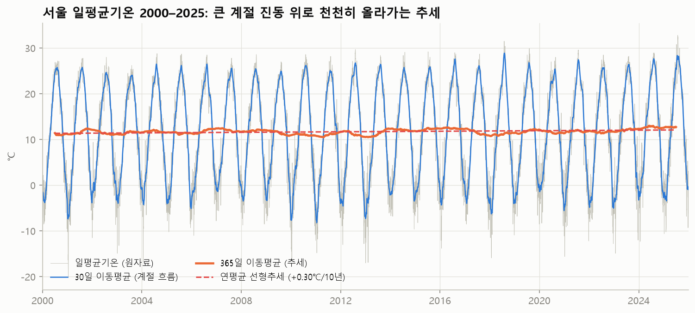
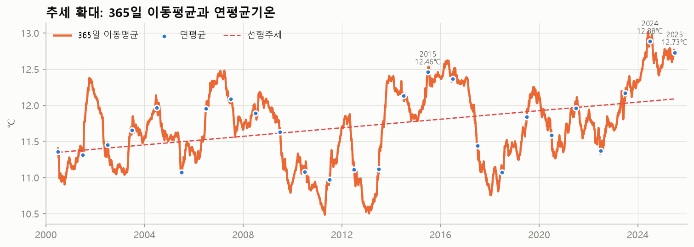
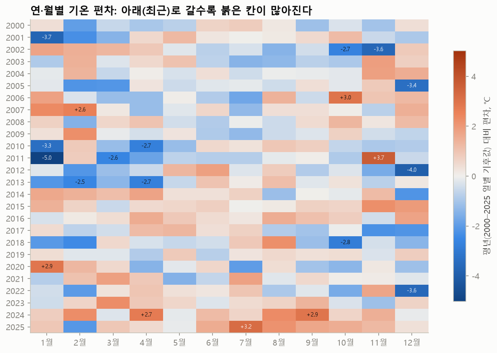
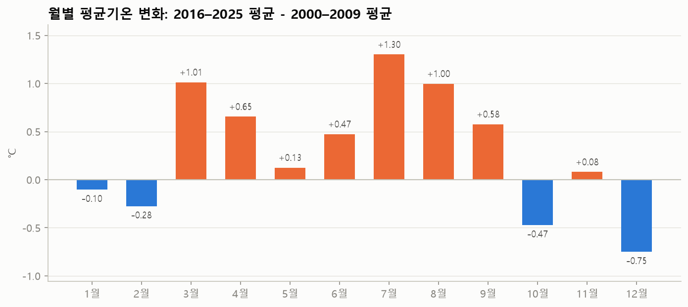
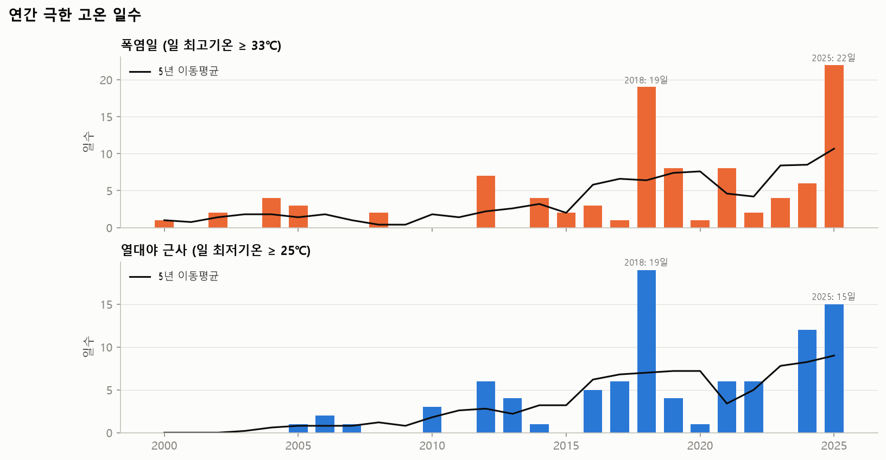
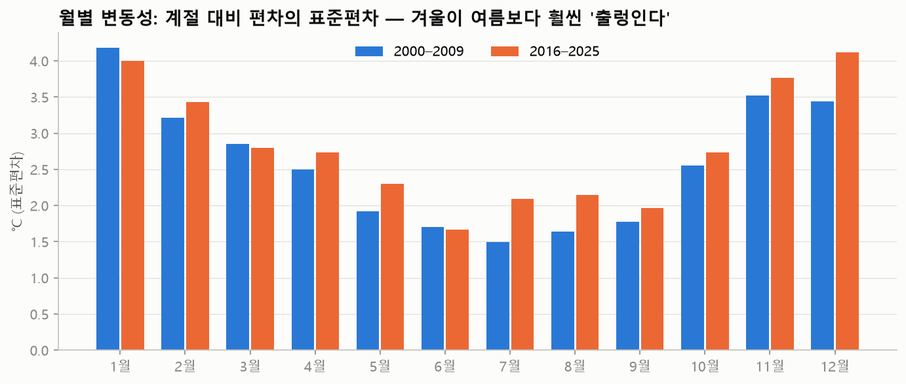
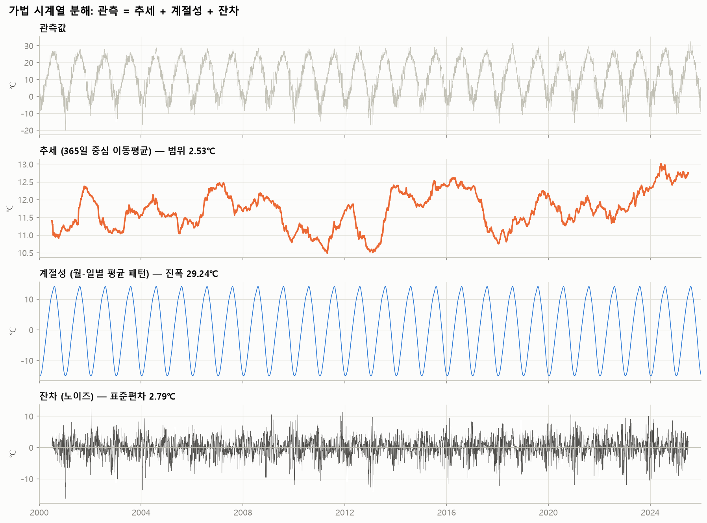
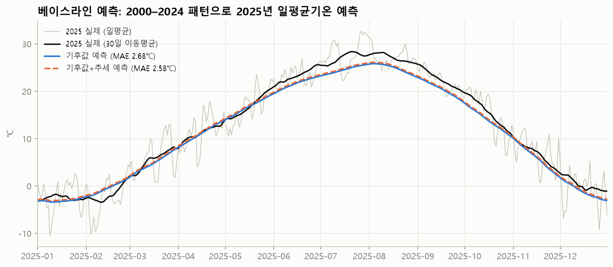

# 서울은 얼마나, 그리고 '언제' 더워지고 있나 — 서울 일별 기온 26년(2000–2025) 시계열 분석

> **한 줄 요약**: 서울의 연평균기온은 10년에 약 0.3℃씩 오르고 있지만, 그 상승은 **여름과 봄에 몰려 있고 겨울은 거의 그대로**다. 그 결과 평균은 조금 올랐을 뿐인데 **폭염일·열대야는 2000년대 대비 6배 이상** 늘었다.

---

## 1. 분석 주제와 동기

"요즘 여름이 예전보다 덥다"는 말은 흔하지만, 그게 **평균이 올라서인지, 극단적인 날이 늘어서인지, 아니면 기억의 착각인지**는 데이터를 봐야 알 수 있다.
일별 기온은 강한 **계절성**(여름-겨울 30℃ 가까운 진동) 위에 느린 **추세**와 매일의 **노이즈**가 겹친 전형적인 시계열이라서, 트렌드·계절성·노이즈를 분리해 보는 연습에 적합하다.

## 2. 분석 질문

| # | 질문 | 유형 |
|---|------|------|
| Q1 | 26년 동안 서울의 기온에 **상승 추세**가 있는가? 있다면 얼마나 큰가? | 그래프로 확인 + 수치 |
| Q2 | 기온 상승은 **모든 달에 고르게** 일어났는가, 특정 계절에 몰려 있는가? | 그래프로 확인 + 해석 필요 |
| Q3 | 평균의 변화에 비해 **극한 고온(폭염일·열대야)** 의 빈도는 어떻게 변했는가? | 그래프로 확인 + 해석 필요 |
| Q4 | 기온의 **변동성(노이즈)** 은 계절마다 어떻게 다르고, 최근 달라졌는가? | 그래프로 확인 |
| Q5 | (심화) 과거 패턴만으로 다음 해(2025)의 일별 기온을 얼마나 맞힐 수 있는가? | 해석 필요 |

## 3. 데이터 설명

| 항목 | 내용 |
|------|------|
| 출처 | [Open-Meteo Historical Weather API](https://open-meteo.com/en/docs/historical-weather-api) (ECMWF **ERA5 / ERA5-Land 재분석** 자료 기반) |
| 위치 | 서울시청 좌표(37.5665N, 126.9780E) 요청 → 실제 격자 37.57N, 126.96E, 고도 34m |
| 기간 | **2000-01-01 ~ 2025-12-31 (9,497일 = 9,497개 데이터 포인트)** |
| 컬럼 | `date`, `temp_mean`(일평균기온 ℃), `temp_max`(일최고), `temp_min`(일최저), `precip`(일강수량 mm) |
| 수집 방법 | `python src/fetch_data.py` (API 키 불필요) → `data/seoul_daily_2000_2025.csv` |
| 라이선스 | **CC BY 4.0** — 재배포 시 "Weather data by Open-Meteo.com" 출처 표기 필요 |

**기본 통계** (원자료)

| | 평균 | 표준편차 | 최소 | 최대 |
|---|---|---|---|---|
| 일평균기온 | 11.72℃ | 10.47 | -20.2℃ (2001-01-15) | 32.8℃ (2025-07-27) |
| 일최고기온 | 16.56℃ | 10.35 | -14.9℃ | 38.5℃ (2025-07-29) |
| 일최저기온 | 7.37℃ | 10.78 | -24.4℃ | 28.1℃ |

> ⚠️ 이 데이터는 **관측소 측정값이 아니라 약 10–25km 격자의 재분석 값**이다. 도시 열섬이 덜 반영돼 기상청 서울 관측소(108)보다 전반적으로 낮게 나오고, 특히 극값(폭염일 수 등)은 공식 통계보다 적게 집계된다. 따라서 이 리포트는 **절대값보다 '같은 자료 안에서의 변화'** 에 초점을 둔다. (→ 8. 한계점)

## 4. 데이터 정제

| 점검 | 기준 | 결과 | 처리 |
|------|------|------|------|
| 날짜 누락 | 2000-01-01~2025-12-31 전체 달력과 비교 | 0일 | 누락이 있었다면 기온은 시간 보간(최대 3일 연속까지), 강수는 보간하지 않도록 코드에 구현 |
| 중복 날짜 | 같은 날짜 2회 이상 | 0건 | – |
| 결측값 | 각 컬럼 NaN | 0개 | – |
| 물리적 오류 | 서울 역대 극값(약 -23℃ / 39.6℃)에 여유를 둔 **[-30, 45]℃ 범위 밖** | 0건 | 있으면 NaN 처리 후 보간 |
| 논리 오류 | `최저 ≤ 평균 ≤ 최고` 위반 | 0건 | – |
| **통계적 이상치** | 계절 대비 편차(anomaly)를 월별 표준편차로 나눈 **\|z\| > 3.5** | **12일** | **삭제하지 않고 플래그만** (`outputs/outlier_days.csv`) |

**이상치를 지우지 않은 이유**: 12일은 2001년 1월 한파(-20.2℃), 2013년 2월 한파, 2025년 7월 말 폭염처럼 **실제로 있었던 기상 사건**이다. 이 분석의 질문(Q3)이 바로 극한 현상이므로, 이를 지우면 답하려는 대상을 스스로 없애는 셈이 된다. 대신 플래그로 표시해 추세 계산에 과도한 영향을 주는지 확인할 수 있게 했다.

> 참고: z-score를 '원래 기온'이 아니라 '계절 대비 편차'에 적용했다. 원래 기온에 바로 적용하면 한여름·한겨울 날이 전부 이상치로 잡히기 때문이다 (계절성이 분산의 90%를 차지 — 6.5 참고).

## 5. 적용한 시계열 기법

| 기법 | 어디에 | 왜 |
|------|--------|----|
| **이동평균** (30일 / 365일, 중심) | Fig 1, 2, 6 | 30일은 계절의 흐름을, 365일은 계절성을 상쇄해 **추세만** 남기기 위해. 365일 창은 1년 주기를 정확히 한 번 덮으므로 계절 진동이 사라진다 |
| **변화율** (전년 대비 차이·%, 전일 대비 변화량) | `annual_summary.csv`, Fig 7 | 해마다 얼마나 출렁이는지, 하루 사이 급변이 언제 많은지 |
| **구간별 통계** (2000–2009 vs 2016–2025) | Fig 4, 5 | 10년 평균끼리 비교해 해마다의 우연한 변동을 줄이기 위해 |
| **월별 집계 · 연×월 피벗** | Fig 3, 4, 7 | 계절마다 변화가 다른지 보려면 월 단위로 쪼개야 함 |
| **변동성 (편차의 표준편차)** | Fig 7 | 노이즈의 크기를 계절별·구간별로 비교 |
| **선형회귀 추세 + 95% 신뢰구간** | Fig 1, 2 | 추세의 크기를 "℃/10년" 하나의 숫자로 요약하고 불확실성을 함께 제시 |
| **(심화) 가법 분해** | Fig 6 | 관측 = 추세 + 계절성 + 잔차로 나눠 각 성분의 크기 비교 |
| **(심화) 베이스라인 예측** | Fig 8 | 2000–2024로 2025를 예측해 "과거 패턴이 얼마나 유효한가" 검증 |

---

## 6. 시각화와 인사이트

각 항목은 **관찰(그래프·수치로 확인한 사실)** 과 **해석(그 이유에 대한 가설)** 을 구분해 적었다.

### 6.1 [Q1] 상승 추세는 있다 — 하지만 계절 진동에 비하면 아주 작다




**관찰**
- 연평균기온의 선형추세는 **+0.30℃/10년** (95% 신뢰구간 +0.04 ~ +0.55℃). 구간이 0을 포함하지 않으므로 상승 방향은 통계적으로 뒷받침된다.
- 365일 이동평균은 시작점 **11.40℃ → 끝점 12.73℃**. 26년 중 가장 따뜻한 해 1·2위가 **2024년(12.88℃), 2025년(12.73℃)** 로 최근 2년이다.
- 하지만 추세선은 거의 평평해 보인다. 매년 반복되는 계절 진동(약 30℃) 위에서 26년간 1℃ 남짓 오른 것이기 때문이다.
- 추세가 일직선이 아니다. 2010–2013년에 10.5–11℃ 근처로 **꺼졌다가** 2014–2016년에 급반등하고, 2017–2018년에 다시 내려갔다 2023년 이후 가파르게 오른다. 전년 대비 최대 상승은 2014년(+1.02℃), 최대 하락은 2017년(-0.93℃).

**해석(가설)**
- 몇 년 단위의 오르내림이 추세(10년에 0.3℃)보다 커서, **3–5년만 보고 "더워졌다/추워졌다"를 판단하면 틀리기 쉽다.** 2013년에 "지난 10년간 서울은 오히려 추워졌다"고 결론 내렸다면 데이터상으로는 맞았겠지만 장기 추세와는 반대였다.
- 2010–2013년의 저점은 혹한 겨울(2011년 1월 편차 -5.0℃, 2012년 12월 -4.0℃ — Fig 3)이 끌어내린 것으로, 엘니뇨·라니냐나 북극 한기 남하 같은 **자연 변동**의 영향일 가능성이 있다(이 데이터만으로는 검증 불가).

### 6.2 [Q2] 따뜻해진 건 여름과 봄 — 겨울은 오히려 정체




**관찰**
- 2016–2025 평균에서 2000–2009 평균을 뺀 월별 변화: **7월 +1.30℃, 3월 +1.01℃, 8월 +1.00℃**가 가장 크다. 반면 **12월 -0.75℃, 10월 -0.47℃, 2월 -0.28℃, 1월 -0.10℃** 는 오히려 낮아졌다.
- 계절로 묶으면 **여름 +0.92℃, 봄 +0.60℃, 가을 +0.06℃, 겨울 -0.38℃**.
- 26년 전체 월별 선형추세로 봐도 같은 그림이다: 7월 +0.74, 3월 +0.69, 8월 +0.59℃/10년 vs 12월 -0.35℃/10년.
- 히트맵(Fig 3)에서 2018년 이후 **6–9월 칸은 대부분 붉은색**인데, 12–2월 칸은 2018·2022년처럼 진한 파란색이 계속 섞여 나온다.

**해석(가설)**
- 서울의 온난화는 '모든 날이 조금씩 따뜻해지는' 형태가 아니라 **여름 쪽으로 쏠린 비대칭**이다. 체감상 "여름은 더 덥고 겨울 추위는 여전하다"는 말이 데이터와 일치한다.
- 겨울이 정체된 것은 기후 연구에서 말하는 "동아시아 겨울 한파의 잦은 발생"(북극 온난화로 제트기류가 약해져 한기가 내려온다는 가설)과 방향이 맞지만, 이 분석은 **원인을 검증한 것이 아니다.** 또 겨울은 변동성이 크기 때문에(6.4) 10년 평균 비교로도 우연의 영향이 크다. 겨울 추세 -0.35℃/10년은 "식고 있다"기보다 **"따뜻해지는 신호가 노이즈에 묻혀 보이지 않는다"** 정도로 읽는 게 안전하다.

### 6.3 [Q3] 평균은 0.3℃ 올랐는데 폭염일은 6배 늘었다



**관찰**
- **폭염일**(일 최고기온 ≥ 33℃): 2000–2009 평균 **연 1.2일 → 2016–2025 평균 연 7.4일** (약 6배).
- **열대야 근사**(일 최저기온 ≥ 25℃): **연 0.4일 → 연 7.4일** (약 18배). 2000–2004년에는 한 번도 없었다.
- 두 지표 모두 2018년(폭염 19일·열대야 19일)과 2025년(폭염 22일·열대야 15일)이 두드러진다. 5년 이동평균은 2015년 무렵부터 계단식으로 올라선다.
- 흥미롭게도 **2018년의 연평균기온(11.07℃)은 26년 중 3번째로 낮다**. 1–2월 한파(편차 -2.1℃, -2.4℃)와 10월(-2.8℃)이 낮았던 반면 8월은 +2.2℃로, 극단이 한 해에 같이 있었다.
- 같은 비교 구간에서 일평균기온 연평균 차이는 **+0.30℃**(11.64 → 11.94℃)에 불과하다.

**해석(가설)**
- 이것은 **분포 꼬리 효과**로 설명된다. 7–8월 최고기온 분포의 평균이 33℃보다 한참 아래에 있을 때, 평균이 1℃만 오른쪽으로 이동해도 33℃를 넘는 '꼬리' 면적은 몇 배로 커진다. 게다가 7–8월의 변동성(편차 표준편차)도 1.5–1.6℃ → 2.1℃로 커져(Fig 7) 꼬리가 더 두꺼워졌다.
- 즉 **연평균 하나만 보고 기후 위험을 판단하면 안 된다.** 2018년처럼 연평균은 낮은데 여름은 역대급인 해가 있다. 건강·전력 수요·냉방 같은 의사결정에는 평균이 아니라 **임계값 초과 일수**를 봐야 한다.
- 절대 일수는 재분석 자료라 공식 통계보다 적을 것이다(3. 데이터 설명). 그러나 같은 자료 안에서의 **상대적 증가**는 신뢰할 만하다고 판단했다.

### 6.4 [Q4] 겨울의 '출렁임'은 여름의 2배 이상



**관찰**
- 계절 대비 편차의 표준편차: **1월 4.23℃, 12월 3.81℃ vs 6월 1.69℃, 7월 1.80℃** — 겨울이 여름의 약 2.3배.
- 전일 대비 평균 변화폭(|Δ|)도 **12월 2.31℃, 1월 2.14℃ vs 8월 0.82℃**.
- 하루 사이 가장 크게 떨어진 날: 2023-01-24 (**-12.9℃**), 2022-11-30 (-12.5℃), 2023-11-24 (-11.7℃) — 모두 늦가을·겨울.
- 구간 비교: 7월(1.49 → 2.09℃), 8월(1.64 → 2.14℃), 12월(3.44 → 4.11℃)의 변동성이 최근 커졌다.

**해석(가설)**
- 겨울에는 시베리아 대륙 고기압의 확장·약화에 따라 찬 공기와 온화한 공기가 번갈아 들어와 **기단 교대에 따른 급변**이 잦고, 여름은 북태평양 고기압과 습한 공기 아래에서 기온이 비교적 안정적이라는 기상학적 설명과 일치한다.
- 실무적 의미: 같은 "±2℃ 오차"라도 여름엔 큰 오차, 겨울엔 평범한 날씨 변동이다. **기온 기반 수요 예측(난방·의류·전력)은 겨울에 더 넓은 불확실성 구간을 잡아야 한다.**
- 변동성이 커진 여름은 6.3의 폭염 증가와 맞물린다. 다만 10년 구간의 표준편차 비교라 표본 오차가 크고, 2018·2025 같은 몇몇 해가 끌어올렸을 수 있다.

### 6.5 [심화 A] 시계열 분해: 기온 변화의 90%는 계절, 추세는 0.3%



방법: **추세** = 365일 중심 이동평균, **계절성** = (관측 − 추세)를 월-일별로 평균한 뒤 ±15일 평활, **잔차** = 관측 − 추세 − 계절성 (가법 모형).

**관찰**
- 계절성 진폭(최고-최저) **29.2℃**, 추세의 변동 폭 **2.5℃**, 잔차 표준편차 **2.8℃**.
- 일별 기온 분산 중 **계절성 89.8%, 잔차 7.1%, 추세 0.3%**.
- 추세 성분은 직선이 아니라 3–5년 주기의 파동이 있고, 2024년에 26년 중 최고 수준(약 13.0℃)에 도달한 뒤 12.5℃ 이상을 유지하고 있다.
- 잔차 패널에서 큰 음(-)의 스파이크는 대부분 겨울(한파)이다 — 6.4의 겨울 변동성과 같은 현상.

**해석(가설)**
- "기온"의 하루하루 차이는 거의 다 계절로 설명되고, 추세는 분산으로는 0.3%밖에 안 된다. 그래도 6.3에서 보듯 이 작은 추세가 **임계값 근처에서는 큰 차이**를 만든다. 작은 성분이라고 중요하지 않은 것은 아니다.

### 6.6 [심화 B / Q5] 베이스라인 예측: 과거 평균은 2025년을 '체계적으로 과소예측'했다



2000–2024년만으로 2025년 365일의 일평균기온을 예측해 실제와 비교했다.

| 방법 | 가정 | MAE | RMSE | 평균 편향 |
|------|------|-----|------|-----------|
| 계절 나이브 | 올해 = 작년 같은 날 | 3.22℃ | 4.07 | +0.19 |
| 기후값 | 올해 = 25년 평균(±15일 평활) | 2.68℃ | 3.26 | **-1.05** |
| **기후값 + 선형추세** | 기후값에 추세로 2025년 보정(+0.30℃) | **2.58℃** | 3.18 | -0.74 |
| (참고) 지속성 | 오늘 = 어제 | 1.70℃ | 2.27 | 0.01 |

**관찰**
- 1년 앞을 보는 세 방법 중 **기후값+추세**가 가장 낫지만, 기후값 대비 개선은 0.1℃에 그친다.
- 두 기후값 방법 모두 편향이 음수, 즉 2025년을 **평균 0.7–1.0℃ 낮게** 예측했다. 월별로 보면 **7월 오차가 -3.3℃**로 가장 크다(실제가 훨씬 더웠다). 2월만 +2.2℃로 실제가 더 추웠다.
- '어제=오늘' 방식이 1.70℃로 가장 정확해 보이지만, 이는 **하루 전 관측값을 쓰는 1일 예측**이라 1년 앞 예측과 공정한 비교가 아니다.

**가정과 한계**
- 이 모델들은 "미래의 계절 패턴은 과거 평균과 같다"고 가정한다. 6.2처럼 계절마다 추세가 다르면(여름↑, 겨울→) 전체 연평균 추세 하나로 보정하는 것은 여름엔 부족하고 겨울엔 과하다. **월별로 다른 추세를 적용**하면 개선될 여지가 있다.
- 2025년 7월 같은 이례적 폭염은 어떤 평균 기반 방법도 예측할 수 없다. 이런 방법의 MAE(약 2.6℃)는 '날씨'라는 노이즈의 크기(잔차 표준편차 2.8℃)와 비슷하며, **기후 수준의 기대값**이지 날씨 예보가 아니다.

---

## 7. 결론

| 질문 | 답 |
|------|----|
| Q1 추세 | **있다.** +0.30℃/10년 (95% CI 0.04–0.55). 최근 2년이 26년 중 가장 따뜻했다. 단, 3–5년 단위 오르내림이 추세보다 크다 |
| Q2 계절 | **고르지 않다.** 여름 +0.92℃, 봄 +0.60℃ vs 겨울 -0.38℃ (두 10년 구간 비교) |
| Q3 극한 | **평균보다 훨씬 빠르게 증가.** 폭염일 연 1.2 → 7.4일, 열대야 0.4 → 7.4일 |
| Q4 변동성 | 겨울 노이즈가 여름의 2배 이상. 최근 7–8월과 12월의 변동성이 커졌다 |
| Q5 예측 | 과거 평균은 2025년을 약 0.7–1.0℃ 과소예측. 추세 보정은 도움이 되지만 여름 폭염은 못 잡는다 |

**그래서 이게 무슨 의미인가?**
서울의 기후 변화는 "조금 따뜻해졌다"는 평균 이야기보다 **"여름의 극단이 잦아졌다"** 는 꼬리 이야기다. 연평균 0.3℃ 상승은 일상에서 느끼기 어렵지만, 폭염일이 해마다 1일에서 7일로 늘어난 것은 냉방 전력·온열질환·야외 근로 일정에 직접 영향을 준다. 반대로 겨울은 아직 따뜻해지는 신호가 노이즈에 묻혀 있고 변동성이 커서, **"따뜻해졌으니 한파 대비를 줄여도 된다"는 판단은 이 데이터로 뒷받침되지 않는다.**

## 8. 한계점

1. **재분석 격자 자료**: 관측소가 아닌 약 10–25km 격자 값이라 도시 열섬과 국지 극값이 덜 반영된다. 절대값(특히 폭염일 수)은 기상청 공식 통계와 다르다. 결론은 같은 자료 내 **상대 변화**로 한정한다. → 개선: 기상청 기상자료개방포털의 서울(108) ASOS 일자료로 같은 코드를 재실행해 비교.
2. **짧은 기간**: 기후 판단에는 보통 30년 이상을 쓴다. 26년, 특히 10년 구간 비교는 자연 변동(엘니뇨 등)의 영향을 크게 받는다.
3. **신뢰구간 과소추정 가능성**: 선형추세의 95% CI는 연평균값들이 서로 독립이라고 가정했다. 실제로는 이웃한 해끼리 상관이 있어 불확실성이 더 클 수 있다.
4. **열대야 정의 근사**: 공식 열대야는 '18:01~익일 09:00 최저기온 ≥ 25℃'이지만 이 자료는 일(0–24시) 최저기온이라 근사치다.
5. **인과 미검증**: 겨울 정체·여름 변동성 증가의 원인(북극 온난화, 고기압 배치 등)은 **가설**이며, 이 분석은 상관·패턴만 보여 준다.
6. **분해·예측 단순화**: 고전적 이동평균 분해는 양 끝 6개월에 추세 값이 없고, 계절 패턴이 26년간 고정이라고 가정한다(6.2에 따르면 실제로는 계절 패턴도 변하고 있다).

---

## 9. 재현 방법

```bash
pip install -r requirements.txt
python src/fetch_data.py     # 데이터 수집 (data/에 이미 포함되어 있으면 생략 가능)
python src/analysis.py       # 정제·분석·그림 8개·outputs/ 생성
```

산출물: `figures/*.png`(그림 8개), `outputs/summary.json`(리포트의 모든 수치), `outputs/*.csv`(연·월 집계, 이상치 목록, 2025 예측값), `dashboard/data.js`(대시보드 데이터).

## 10. 보너스: 대시보드

**배포 URL: https://yjh88.github.io/ai_data_analysis/dashboard/** · `dashboard/index.html` — 기간(시작·종료 연도), 월(복수 선택), 지표(평균·최고·최저), 이동평균 창(7/30/90/365일), 임계값을 바꿔 가며 탐색. 실행 방법과 시나리오별 스크린샷은 [docs/DASHBOARD.md](docs/DASHBOARD.md) 참고.

---

## 11. AI 사용 로그

이 분석은 AI 코딩 어시스턴트(Claude, Claude Code)와 함께 진행했다. 최종 해석·결론은 아래 검증을 거친 수치에 근거해 판단했다.

| # | 사용 작업 | 사용 이유 | 검증 방법 |
|---|-----------|-----------|-----------|
| 1 | **데이터 소스 탐색·수집 스크립트** 작성 (Open-Meteo API 파라미터 구성) | 시간 절감 — API 키 없이 쓸 수 있는 공개 기상 자료 후보 탐색 | API 응답의 격자 좌표·단위·행 수(9,497 = 26년 일수) 확인, CSV 첫 행을 원본 JSON과 대조 |
| 2 | **전처리 코드** (결측·중복·범위·논리 검사, 이상치 기준) | 대안 탐색 — 원 기온 z-score vs 계절 편차 z-score 중 무엇이 맞는지 | 원 기온에 z-score를 쓰면 계절 극값이 전부 잡히는 문제를 확인하고 편차 기반으로 결정. 플래그된 12일을 날짜별로 열어 실제 한파·폭염 시기인지 확인 |
| 3 | **시계열 기법·시각화 코드** (이동평균, 구간 비교, 히트맵, 분해, 예측) | 시간 절감 + 그래프 디자인 | **AI 코드의 버그를 직접 발견·수정**: 365일 이동평균을 `min_periods=300`으로 두었더니 양 끝에서 창이 여름/겨울 쪽으로 치우쳐 추세 시작·끝값이 13.3℃ / 15.9℃로 비현실적으로 나왔다. 연평균(11–13℃)과 맞지 않아 `min_periods=365`로 고쳤고 11.4℃ / 12.7℃로 정상화. 그 외 라벨 잘림·마이너스 기호 깨짐도 그림을 직접 열어 보고 수정 |
| 4 | **대시보드** (HTML + Chart.js) 작성 | 보너스 과제 시간 절감 | **독립 재계산 비교**: 대시보드에서 '7–8월·일최고기온' 선형추세가 +0.83℃/10년으로 나왔는데, pandas로 따로 계산한 값(0.827)과 일치. 전체 기간 평균 11.72℃도 `describe()` 값과 일치 |
| 5 | **해석 초안·문장 다듬기** | 대안 탐색 — 패턴에 대한 기상학적 설명 후보 수집 | 모든 '관찰' 수치는 `outputs/summary.json`에서 다시 확인. AI가 제시한 원인 설명(북극 온난화, 기단 교대 등)은 이 데이터로 검증할 수 없으므로 **'해석(가설)'로만** 표기하고 결론에서 인과로 쓰지 않음 |

**AI 결과를 그대로 쓰지 않은 지점**
- 처음 계획한 폭염일 수를 '서울 공식 폭염일'처럼 쓰려 했으나, 재분석 자료라 공식 값보다 작게 나올 수 있다는 점을 확인하고 "같은 자료 내 상대 변화"로 해석 범위를 좁혔다.
- '어제=오늘' 예측이 MAE가 가장 낮았지만, 1일 예측과 1년 예측을 같은 표에서 이겼다고 말하면 오해를 주므로 '참고'로 분리했다.
