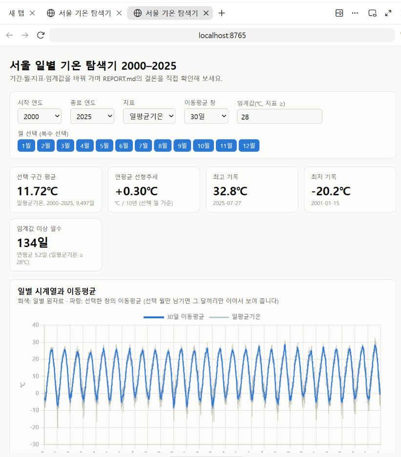
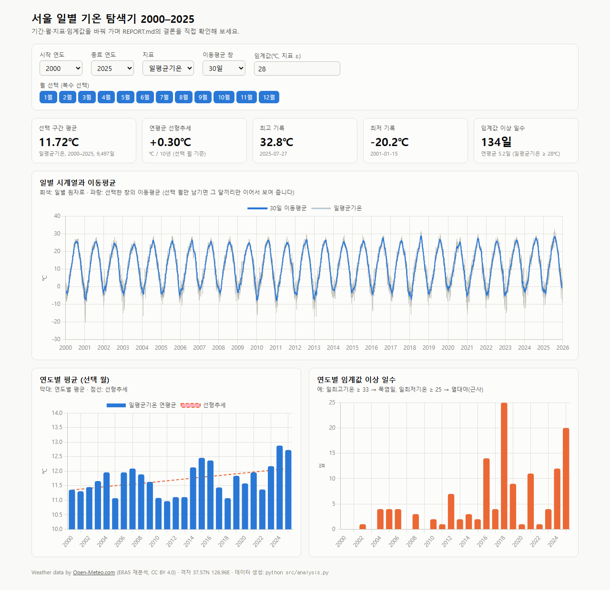
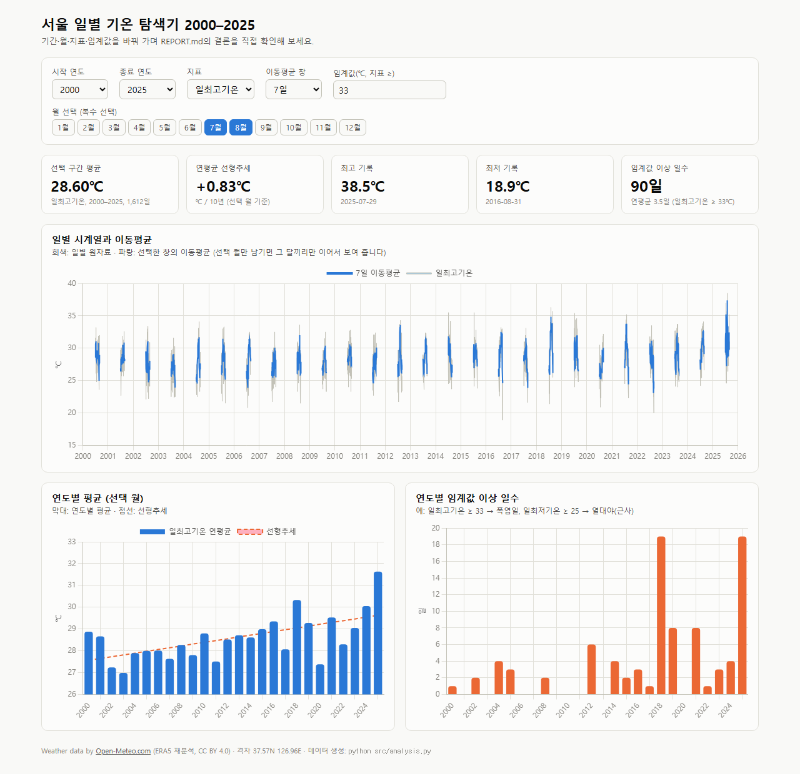
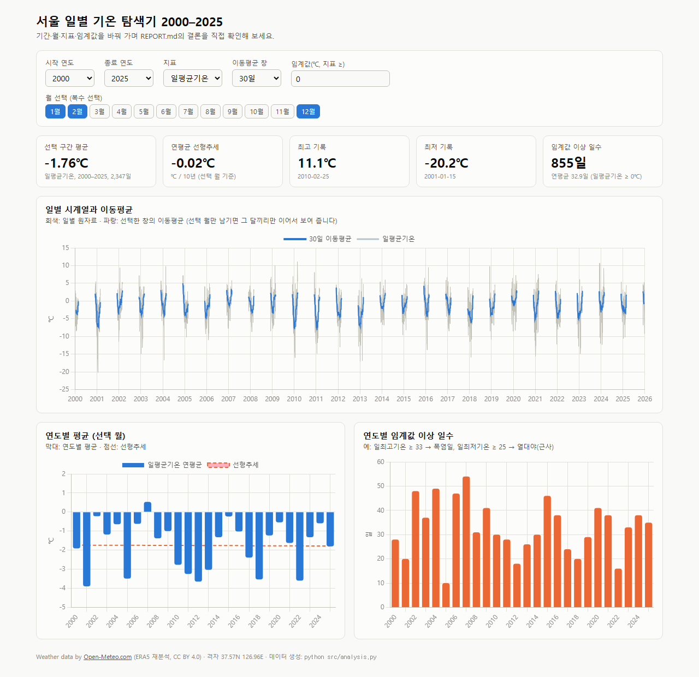
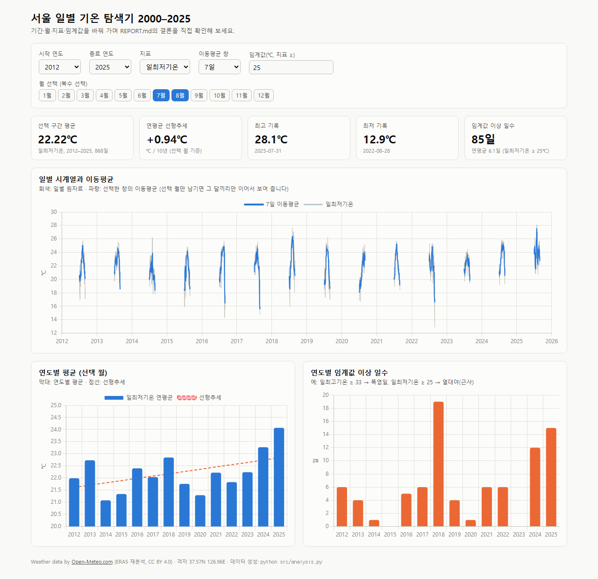

# 대시보드: 서울 일별 기온 탐색기

분석 결과를 기간·조건을 바꿔 가며 직접 확인하는 정적 웹 대시보드(`dashboard/index.html`)입니다.
제출 방식: **(3) 대시보드 스크린샷 세트 + 필터/기간 변경 시나리오 설명** (+ 로컬 실행 방법).

## 실행 방법

```bash
python src/analysis.py                                  # dashboard/data.js 생성 (이미 있으면 생략 가능)
python -m http.server 8765 --directory dashboard        # 로컬 서버 실행
# 브라우저에서 http://localhost:8765 접속
```

- 서버 없이 `dashboard/index.html`을 바로 열어도 동작합니다 (데이터는 `data.js`로 함께 로드).
- 차트 라이브러리 Chart.js 4.4.1을 CDN(cdnjs)에서 불러오므로 인터넷 연결이 필요합니다.
- 필터 상태를 URL로 공유할 수 있습니다: `?y0=2012&y1=2025&metric=3&months=7,8&thr=25&win=7`
  (`metric` 1=평균, 2=최고, 3=최저 · `months` 쉼표 구분 · `win` 이동평균 일수 · `thr` 임계값)

### 로컬 실행 화면
위 명령으로 실행한 뒤 브라우저에서 `localhost:8765`에 접속한 화면입니다.



전체 페이지(KPI·차트 3개 모두 포함):



## 화면 구성

| 영역 | 내용 |
|------|------|
| 필터 | 시작/종료 연도, 지표(일평균·일최고·일최저), 이동평균 창(7·30·90·365일), 임계값(℃), 월 복수 선택 |
| KPI | 선택 구간 평균, 연평균 선형추세(℃/10년), 최고·최저 기록과 날짜, 임계값 이상 일수 |
| 차트 1 | 일별 원자료 + 이동평균 (선택한 월만 표시) |
| 차트 2 | 연도별 평균(선택 월) + 선형추세 |
| 차트 3 | 연도별 임계값 이상 일수 |

## 시나리오

### ① 기본 화면 — 전체 기간·전체 월·일평균기온
`http://localhost:8765/`


- 연평균 추세 **+0.30℃/10년**, 전체 평균 11.72℃ → REPORT 6.1과 동일한 값.
- 일평균 ≥ 28℃ 일수 막대가 2018년·2024–2025년에 몰려 있음을 바로 볼 수 있다.

### ② 여름(7–8월) 일최고기온 + 임계값 33℃ = 폭염일
`?metric=2&months=7,8&thr=33&win=7`



- 월을 7·8월만 남기고 지표를 '일최고기온'으로 바꾸면, 추세가 **+0.83℃/10년**으로 전체 연평균(+0.30)의 약 3배가 된다 → "온난화는 여름에 쏠려 있다"(REPORT 6.2)를 필터 두 번으로 확인.
- 최고 기록 38.5℃ (2025-07-29), 오른쪽 차트에서 2018·2025년 폭염일이 두드러진다.

### ③ 겨울(12·1·2월) 일평균기온 + 임계값 0℃ = 영상(0℃ 이상) 일수
`?metric=1&months=12,1,2&win=30&thr=0`



- 같은 방식으로 겨울만 보면 추세가 거의 0(약 -0.02℃/10년)이고, 연도별 막대가 크게 출렁인다 → "겨울은 따뜻해지는 신호가 노이즈에 묻혀 있다"(REPORT 6.2, 6.4).
- 최저 기록 -20.2℃ (2001-01-15). 겨울철 영상 일수는 연평균 32.9일이지만 2005년 10일 ~ 2007년 54일로 해마다 차이가 크다.

### ④ 최근 14년(2012–2025) 여름 일최저기온 ≥ 25℃ = 열대야(근사)
`?y0=2012&y1=2025&metric=3&months=7,8&thr=25&win=7`



- 기간을 좁히면 KPI가 그 기간 기준으로 다시 계산된다. 7–8월 열대야 근사일 합계 85일, 2018·2024·2025년 집중.
- 기간을 2000–2011로 바꾸면 일수가 크게 줄어드는 것과 비교해 볼 수 있다.

## 검증
대시보드의 계산(JavaScript)은 pandas 분석과 독립적으로 구현했으며, 아래 값이 일치함을 확인했다.

| 항목 | 대시보드 | pandas |
|------|----------|--------|
| 전체 평균 일평균기온 | 11.72℃ | 11.72℃ |
| 7–8월 일최고기온 추세 | +0.83℃/10년 | +0.827℃/10년 |
| 2012–2025 7–8월 최저 ≥ 25℃ 일수 | 85일 | 85일 |
